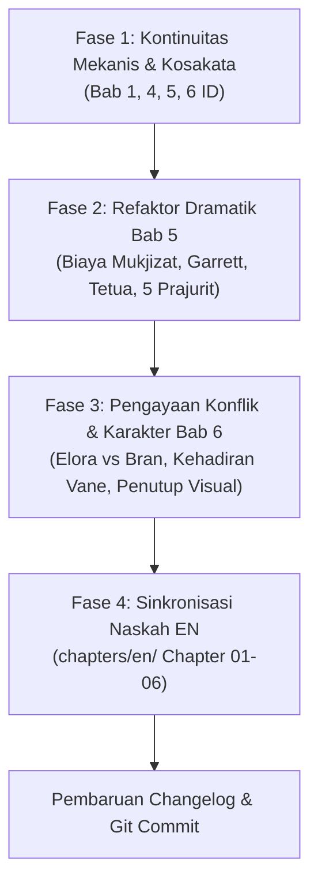

# Rencana Pengembangan & Revisi Editorial Bab 1–6
**Novel:** *Gema Sang Utusan*  
**Dokumen Peninjauan:** Evaluasi Kritis dan Rencana Aksi Terstruktur atas Brief Editorial Bab 1–6

---

## 1. Ringkasan Eksekutif & Evaluasi Kritis

Brief editorial dari Claude memberikan analisis yang sangat tajam dan bernilai tinggi bagi pematangan kualitas sastrawi Bab 1 s/d Bab 6. Temuan utama yang disorot berakar pada dua pilar:
1. **Ketegangan Dramatis & Konsekuensi Nyata:** Mukjizat penyembuhan Azariel di Bab 5 belum menuntut "harga fisik", kepatuhan Garrett terjadi terlalu instan tanpa gesekan loyalitas militer, dan empat perpisahan di Bab 6 berpola seragam tanpa konflik personal.
2. **Kontinuitas & Realisme Bahasa:** Ditemukan anakronisme kata modern (*ozon*), kontradiksi linimasa wafatnya ibu Mira (15 musim vs 19 tahun), penggunaan meta-label *Echoes of Humanity* dalam batin Azariel, serta hilangnya tokoh oposisi desa ([[vane|Vane]]) di Bab 3–6.

Secara umum, **hampir seluruh poin masukan editor sangat layak dan direkomendasikan untuk diterapkan**. Namun, ada beberapa penyesuaian taktis agar perbaikan tidak merusak fondasi emosional yang sudah terbangun dengan baik pada Bab 5 dan 6.

---

## 2. Rencana Aksi Bertahap (Phased Roadmap)

Rencana pengembangan ini dibagi menjadi empat fase kerja terukur agar perubahan tetap terkendali dan mudah diaudit.

---

### Fase 1: Perbaikan Kontinuitas Mekanis & Kosakata (Prioritas 1)
*Tujuan: Membersihkan kesalahan faktual, anakronisme istilah, dan meta-label.*

1. **Koreksi Linimasa Wafat Ibu Mira (`chapter_06.md` L86):**
   * *Masalah:* Ayah Mira menyebut ibunya menolong wabah "lima belas musim silam". Menurut [[mira|Profil Karakter Mira]], sang ibu wafat saat melahirkan Mira (Mira kini berusia 19 tahun).
   * *Aksi:* Ubah menjadi *"Dua puluh musim silam, sebelum kau lahir, saat wabah demam melanda pemukiman bawah..."* Ini menjaga kanon bahwa ibu Mira adalah sosok tabib legendaris tanpa mencederai usia Mira.
2. **Eliminasi Kata Anakronistik Modern "Ozon":**
   * *Masalah:* Kata *ozon* adalah istilah kimia modern abad ke-19 yang melanggar [[Panduan.md]] (Mortal Sensory Realism).
   * *Lokasi:* `chapter_01.md:L97`, `chapter_04.md:L153`, `chapter_05.md:L53`.
   * *Aksi:* Ganti dengan persepsi sensorik alami masyarakat pegunungan: *aroma batu terbakar*, *hawa logam beku*, atau *bau jelaga dan abu mati*.
3. **Penghapusan Meta-Label *Echoes of Humanity* (`chapter_05.md:L85`):**
   * *Masalah:* Azariel belum mengetahui nama resmi ketujuh pecahan Jantung Aethel di Bab 5. Menampilkan nama pecahan sebagai teks miring dalam benak tokoh merusak sudut pandang orang ketiga terbatas (*Third-Person Limited*).
   * *Aksi:* Hapus tulisan `*Echoes of Humanity.*` Biarkan kilasan sensorik (aroma sup labu, tawa riang sang ibu, jeritan di ngarai utara) mengalir murni sebagai memori emosional yang diserap Azariel.
4. **Pembersihan Residu Diksi Abstrak (`chapter_06.md:L138`):**
   * *Aksi:* Ganti kata *"esensi"* dan *"tatanan yang abstrak"* dalam monolog batin Azariel dengan diksi membumi: *"wujud nyata dari seluruh harapan fana"* dan *"kemuliaan yang muluk-muluk"*.

---

### Fase 2: Restrukturisasi Dramatik Bab 5
*Tujuan: Memberi bobot pengorbanan pada mukjizat, menajamkan wibawa Kapten Garrett, dan merapikan transmisi rahasia.*

1. **Pemberian Harga Fisik pada Mukjizat Pemurnian (Bagian 3.1):**
   * *Masalah:* Azariel menyerap luka korosi mematikan hanya dengan satu tetes air mata. Hal ini membuat ancaman *The Husk* terasa kurang berbahaya dan mukjizat terkesan "terlalu murah".
   * *Aksi:* Berikan konsekuensi fisik yang nyata dan bertahan hingga Bab 6:
     * Saat melarutkan abu korosi, tangan kanan Azariel terpapar kebekuan ekstrem: kulit telapak dan punggung tangannya memucat kelabu dingin, mati rasa hingga ke pergelangan, dan tubuhnya gemetar lemas.
     * Azariel menyembunyikan tangannya yang membeku ke balik lipatan lengan jubah lenannya agar Mira tidak panik.
     * Di Bab 6, tangan ini masih terasa kaku dan dingin saat Azariel menyentuh batang Pohon Ara Tua, menjadi alasan organik mengapa Mira mengawasinya dengan cemas.
2. **Penajaman Dinamika Kapten Garrett (Bagian 3.2):**
   * *Masalah:* Saat Bran menodongkan pisau, Garrett langsung berlutut, menangis, dan berpidato panjang. Perilaku ini kurang mencerminkan perwira veteran 25 musim dinas di Garda Utama.
   * *Aksi:*
     * Garrett tidak langsung berlutut pasrah. Ia membalas tatapan Bran dengan ketegaran seorang komandan yang letih namun bermartabat. Tangannya sempat menyentuh gagang pedang di pinggangnya secara naluriah sebelum perlahan ia lepaskan.
     * Garrett mengalami pergulatan loyalitas nyata: sumpah dinasnya kepada Adipati Leovard menuntutnya melaporkan setiap anomali berkekuatan sihir, namun hati nuraninya melihat keselamatan 300 prajurit di utara dan rakyat fana.
     * Pangkas monolog pidato Garrett agar lebih padat, getir, dan bernas.
3. **Restrukturisasi Dialog Tetua Desa (Bagian 3.3):**
   * *Masalah:* Tetua menjabarkan seluruh informasi (asal Husk, kelaparan akan bara, nasib desa) sekaligus dalam satu tarikan dialog.
   * *Aksi:* Ubah menjadi dialog bersubteks yang bersahaja: Tetua merujuk pada peringatan tradisi lisan leluhur tanpa membeberkan teori kosmologi secara gamblang.
4. **Logika Keberadaan 5 Prajurit Pengintai Leovard (Bagian 3.4):**
   * *Masalah:* Di Bab 4 Garrett datang bersama regu pengintai, dan di Bab 6 ada 5 prajurit berkuda mengawal rombongan. Siapa yang tahu rahasia Azariel?
   * *Aksi:* Tegaskan bahwa **kelima prajurit pengintai diistirahatkan di kandang barat dan sama sekali tidak melihat proses mukjizat di bilik perawatan**. Garrett dan Bran sengaja mengunci pintu bilik. Garrett menginstruksikan pasukannya bahwa pemuda berkerudung itu adalah tabib/pemandu rahasia dari lembah atas perintah Tetua Desa. Kerahasiaan ini menjaga konflik saat mereka tiba di Kadipaten Leovard.

---

### Fase 3: Pengayaan Konflik & Karakter Bab 6
*Tujuan: Memecah pola perpisahan yang seragam, menanam benih intrik desa, dan memperbaiki penutup bab.*

1. **Variasi Dinamika & Gesekan pada Vignette Perpisahan (Bagian 4.1):**
   * **Vignette Kael (Elora vs Bran):**
     * Jangan jadikan Elora sekadar ibu pasif yang menyerahkan mantel sambil menangis haru.
     * Berikan gesekan rumah tangga yang tajam: Elora menahan mantel itu sejenak, menatap Bran dengan sorot mata pedih seorang ibu. *"Dua puluh musim kau mengajarinya memegang pedang, Bran. Sekarang katakan padaku, untuk apa? Agar dia mati di celah batu seperti kawan-kawanmu dahulu?"*
     * Bran terdiam, membiarkan Kael sendiri yang menjawab ibunya dengan kedewasaan seorang pemuda yang melindungi keluarganya.
   * **Vignette Mira (Pondok Tabib):**
     * Jadikan perpisahan Mira lebih sunyi dan tertahan. Ayah Mira tidak berpidato panjang, melainkan ada keheningan berat saat melihat tas obat putrinya penuh.
   * **Vignette Azariel & Garrett (Ara Tua):**
     * Pertahankan inti dialog tentang sup labu dan tawa anak-anak (usulan Penulis yang sangat kuat). Integrasikan rasa dingin di tangan kanan Azariel yang diam-diam ia genggam untuk menguji apakah kehangatan hidupnya telah kembali.
2. **Re-introduksi Tokoh [[vane|Juragan Vane]] di Bab 6 (Bagian 4.2):**
   * *Masalah:* Vane memegang peran penting di Bab 2 sebagai rival politik Tetua dan pemilik kebun anggur dengan koneksi dagang ke Leovard, namun absen di Bab 3–6.
   * *Aksi:* Hadirkan sosok Vane di gerbang barat desa saat keberangkatan:
     * Vane berdiri di dekat pagar gudang gandum, bersandar pada tongkat berkepala perunggunya, memperhatikan dari kejauhan dengan tatapan kalkulatif.
     * Vane mengamati kuda-kuda perang Leovard dan sosok pemuda asing berkerudung yang dikawal khusus oleh Kapten Garrett.
     * Ini menanam kembali ancaman bahwa kabar keberangkatan Azariel bisa bocor ke telinga Adipati melalui jaringan dagang anggur Vane.
3. **Perbaikan Penutup Bab yang Meringkas Diri (Bagian 4.3):**
   * *Masalah:* Bab 5 dan Bab 6 diakhiri dengan kesimpulan narator (*"telah resmi usai"*, *"telah resmi dimulai"*).
   * *Aksi:* Akhiri Bab 6 dengan **gambar visual dan aksi konkret**: debu jalanan berbatu yang mengepul di bawah tapal kuda, embusan angin gunung yang menyibak mantel mereka saat jalan mulai mendaki ke celah cadas utara, dan siluet lembah hijau yang perlahan tenggelam di balik punggung bukit pinus.

---

### Fase 4: Penyelarasan Naskah Bahasa Inggris
*Tujuan: Menjaga kesetaraan naratif dan standar sastrawi pada direktori `chapters/en/`.*

* Sinkronisasi seluruh perbaikan baris-demi-baris pada `chapter_01.md` s/d `chapter_06.md` dalam versi Bahasa Inggris.
* Memastikan tidak ada residu istilah modern (*ozone*, *particles*, *ontological*) dan menjaga ritme dialog tetap ekspresif sesuai pedoman Bagian 8 `Panduan.md`.

---

## 3. Pertanyaan Kritis & Saran untuk Penulis

Berikut adalah poin-poin keputusan lore dan naratif yang membutuhkan arahan serta persetujuan Penulis sebelum naskah dieksekusi:

### Pertanyaan 1: Mekanisme Transmisi *Corrosion* pada Manusia Hidup
* **Latar Masalah:** Di Bab 4 & 5, prajurit muda Garrett terkena luka abu di lambung akibat serangan The Husk, yang jika tidak disembuhkan akan mengubahnya menjadi cangkang kosong. Padahal di `lore/worldbuilding/factions/the_husks.md`, The Husks adalah pengungsi purba dari era Vivarium.
* **Pertanyaan untuk Penulis:** Apakah *Corrosion* dari The Husk memang bisa menular/menginfeksi manusia hidup di era sekarang seperti wabah nekrotik dingin (yang jika dibiarkan akan melumat jiwa dan mengubah korban baru menjadi Husk tambahan)?
* **Rekomendasi Kami:** **Ya, setujui ini.** Ini membuat ancaman The Husks berkali-kali lipat lebih menakutkan bagi kerajaan manusia—bukan sekadar monster pengembara, melainkan kutukan yang mampu mengubah populasi perbatasan menjadi barisan cangkang hampa jika pertahanan jebol. *(Perlu pembaruan resmi di `lore/worldbuilding/magic/corrosion.md`)*.

---

### Pertanyaan 2: Asal-Usul Kidung Leluhur Bab 2
* **Latar Masalah:** Di Bab 2, Tetua melafalkan syair kuno: *"Di balik kabut zaman yang runtuh, berjalanlah raga yang tak lagi utuh... ia datang bukan untuk membunuh, ia datang untuk mengisi..."*
* **Pertanyaan untuk Penulis:** Jika The Husks terbentuk di Vivarium ribuan musim lalu, bagaimana Tetua kaum *The Remnant* di desa terpencil bisa memiliki kidung yang begitu presisi mendeskripsikan anatomi dan motif The Husk?
* **Rekomendasi Kami:** Kidung tersebut adalah warisan para tetua perintis *The Remnant* yang menjaga perbatasan tebing ribuan musim silam pasca-bencana. Ketika retakan kecil Vivarium sesekali bocor di masa lampau, para leluhur menyaksikan raga-raga hampa tersebut dan merangkum peringatannya ke dalam syair lisan turun-temurun.

---

### Pertanyaan 3: Taruhan Akhir Segel Vivarium di Babak Akhir
* **Pertanyaan untuk Penulis:** Apa tujuan akhir Azariel dalam mengumpulkan ketujuh serpihan Jantung Aethel terkait eksistensi Vivarium?
  * **Opsi A (Penyegelan Mutlak):** Memperkuat kembali segel dimensi agar The Husks terkunci selamanya di luar dunia manusia.
  * **Opsi B (Evakuasi & Pemurnian - Sesuai Outline):** Membuka ambang batas Vivarium untuk melakukan *Pemurnian Kedua*—memadamkan api ungu penderitaan The Husks, memberikan istirahat abadi bagi jiwa-jiwa purba, dan mengubah Vivarium menjadi suaka transit kepulangan jiwa menuju Sang Pencipta.
* **Rekomendasi Kami:** **Opsi B.** Sesuai dengan [[outline.md]] Fase 5 dan karakter moral Azariel yang telah belajar mencintai kerapuhan jiwa manusia fana.

---

### Pertanyaan 4: Penamaan Ayah Mira
* **Pertanyaan untuk Penulis:** Ayah Mira belum memiliki nama hingga Bab 6 (hanya disebut *Ayah Mira* atau *seorang petani gandum bersahaja*). Apakah Penulis ingin memberinya nama resmi, atau sengaja membiarkannya tanpa nama untuk mempertahankan kesan arketipe ayah petani yang bersahaja?
* **Pilihan Nama (jika ingin dinamai):**
  1. **Danu** (nama bersahaja berakar pada tanah/air).
  2. **Joran** (hangat, bersahaja, khas pedesaan Aethelgard).
  3. **Tomas** (klasik petani pedalaman).
  4. **Tetap Tanpa Nama Resmi** (hanya dipanggil *"Ayah"* oleh Mira dan *"menantu Tetua"* oleh warga).

---

### Pertanyaan 5: Pilihan Istilah untuk "Corrosion" dalam Bahasa Indonesia
* **Pertanyaan untuk Penulis:** Dalam naskah Bahasa Indonesia, istilah *Corrosion* saat ini ditulis miring dalam bahasa Inggris (`*Corrosion*`). Manakah pendekatan yang paling Penulis sukai?
  * **Opsi A (Istilah Bahasa Indonesia Murni):** Menggunakan istilah **Korosi Kehampaan** atau **Pembusukan Kelam**.
  * **Opsi B (Istilah Arkais Khusus):** Tetap menggunakan istilah ***Corrosion***, tetapi diberi penjelasan singkat dalam dialog Tetua bahwa itu adalah kata dari bahasa kuno naskah leluhur yang berarti "pelapukan hakikat raga".
* **Rekomendasi Kami:** **Opsi B.** Kata *Corrosion* terdengar arkais dan magis jika Tetua menjelaskannya sebagai nama kutukan dari gulungan kuno, sementara dalam narasi bebas dapat divariasikan dengan *racun pembusukan kelam*.

---

## 4. Matriks Ringkasan Dampak Berkas

| Berkas | Jenis Perubahan | Prioritas | Ketergantungan Keputusan |
| :--- | :--- | :---: | :---: |
| `chapters/id/chapter_01.md` | Hapus kata "ozon" (L97) | P1 | Langsung |
| `chapters/id/chapter_04.md` | Hapus kata "ozon" (L153), selaraskan istilah Corrosion (L183) | P1 | Pertanyaan 5 |
| `chapters/id/chapter_05.md` | Hapus kata "ozon" (L53), hapus label *Echoes of Humanity* (L85), tambahkan konsekuensi fisik mukjizat, tajamkan Garrett & Tetua | P1 & P2 | Pertanyaan 1 & 5 |
| `chapters/id/chapter_06.md` | Koreksi linimasa ibu Mira (L86), bersihkan diksi abstrak (L138), tambah konflik Elora vs Bran, munculkan Vane di gerbang, penutup visual | P1 & P3 | Pertanyaan 4 |
| `chapters/en/chapter_01-06.md` | Sinkronisasi penuh dwibahasa naskah Inggris | P4 | Mengikuti naskah ID |
| `lore/worldbuilding/magic/corrosion.md` | Kodifikasi infeksi manusia hidup (jika disetujui) | P2 | Menunggu Persetujuan Pertanyaan 1 |
| `update/changelog.md` | Pencatatan riwayat revisi resmi | Wajib | Di akhir tiap fase |

---

> [!IMPORTANT]
> **Langkah Selanjutnya:**  
> Mohon telaah dokumen rencana ini dan berikan arahan atau jawaban atas 5 pertanyaan di atas. Begitu Penulis menyetujui atau memberikan penyesuaian, kami akan segera mengeksekusi Fase 1 dan Fase 2 secara bertahap.

